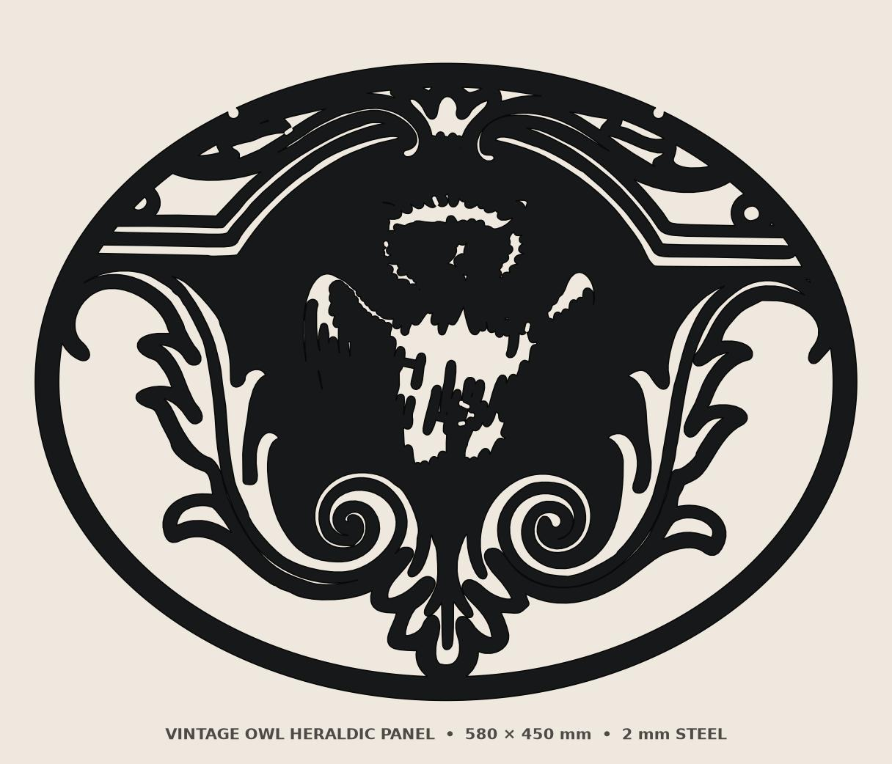

# Vintage Owl Heraldic Panel

A premium oval CNC wall panel adapted from a public-domain 1877 heraldic owl illustration.



## Manufacturing specification

- Finished size: **580 × 450 mm**
- Stock: **2 mm mild steel**
- One connected flat panel
- Two **8 mm** mounting holes
- Minimum measured profile separation: **4.302 mm**
- Net metal area: **135,292.16 mm²**
- Estimated mass: **2.1241 kg**
- **51** closed DXF `LWPOLYLINE`s on `CUT`

## Files

Production DXF/SVG, truthful preview, geometry metrics, exact source SVG, reproducible generator, provenance, and CC0 license are included.

## Reproduce

```bash
uv run --with opencv-python-headless --with ezdxf --with resvg-py --with matplotlib --with shapely python scripts/generate.py
```

## Engineering changes

The generator strengthens the historical linework into positive-metal webs, integrates it with an oval frame, makes four short local joins for meaningful central details, removes one detached 37.37 mm² engraving speck, merges seven close profile pairs, adds mounting holes, and emits audited CAD. No decorative aperture was deleted during final clearance repair.

## License

Source and derivative package: **CC0 1.0 Universal**. See `LICENSE` and `SOURCE.md`.
